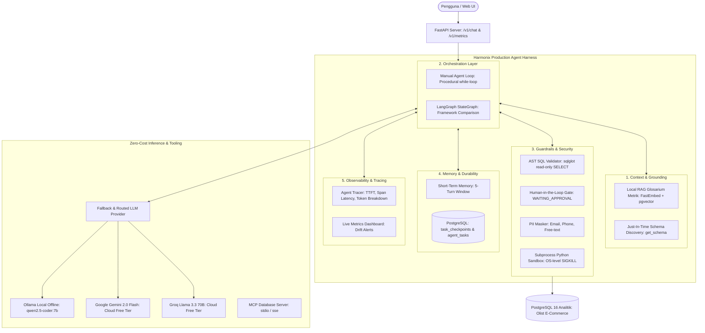

# Harmonix: Production-Grade AI Data Analyst Agent

[](https://www.python.org/downloads/)
[](https://fastapi.tiangolo.com/)
[](https://www.postgresql.org/)
[](https://github.com/langchain-ai/langgraph)
[](https://modelcontextprotocol.io/)
[](#-menjalankan-pengujian-testing)
[](#-evaluasi-benchmark--observabilitas)
[-brightgreen.svg)](#-zero-cost-stack-architecture)

> **Harmonix** adalah proyek referensi produksi untuk posisi **AI Agent Engineer / Senior AI Backend Developer**. Mengubah bahasa alami menjadi query analitik PostgreSQL (*Text-to-SQL*) dengan sabuk pengaman (*agent harness*) produksi lengkap: AST guardrails, human-in-the-loop approval gate, local RAG metric glossary, state persistence di PostgreSQL, observabilitas granular, suite evaluasi benchmark, perbandingan LangGraph, dan Model Context Protocol (MCP) server.

---

## 🌟 Mengapa Membutuhkan "Agent Harness"?

Menyuruh LLM langsung mengeksekusi SQL mentah ke database analitik tanpa pengaman adalah bencana di lingkungan enterprise:
* ❌ **Halusinasi Nama Kolom:** LLM menebak struktur tabel yang tidak ada (*schema drift*).
* ❌ **Risiko Keamanan Fatal:** Potensi serangan injeksi SQL atau perintah merusak (`DROP TABLE`, `DELETE`).
* ❌ **Beban Biaya Komputasi:** Query *unbounded full-table scan* tanpa batas baris dapat merontokkan database.
* ❌ **Kebocoran Data Pribadi:** Data sensitif pelanggan (email, nomor telepon) terekspos tanpa sensor.

**Harmonix memecahkan seluruh risiko di atas** dengan membangun 5 lapisan perlindungan harness di sekeliling model bahasa:



---

## 🚀 Fitur Unggulan Sistem

### 1. AST SQL Guardrails & Sanitizer (`src/tools/guardrails.py`)
* Dibangun menggunakan **`sqlglot`** untuk membedah *Abstract Syntax Tree* (AST) query PostgreSQL.
* **100% Read-Only:** Memblokir seluruh perintah mutasi data atau DDL (`DROP`, `DELETE`, `TRUNCATE`, `INSERT`, `UPDATE`, `ALTER`).
* **Anti-Injection:** Memblokir serangan *multi-statement chaining* (titik-koma `;`) dan pemanggilan fungsi berbahaya (`pg_sleep()`, `pg_read_file()`, `dblink()`).
* **Row-Limit Enforcer:** Secara deterministik menyisipkan klausul `LIMIT 100` pada semua query SELECT yang tidak memiliki batasan.

### 2. Human-in-the-Loop Approval Gate (`src/agent/state.py` & Web UI)
* Mendeteksi query berisiko tinggi (akses data PII sensitif atau multi-table join tanpa filter `WHERE`).
* Menahan eksekusi dan mengubah state task menjadi **`WAITING_APPROVAL`** tanpa memblokir thread server (*non-blocking asynchronous state machine*).
* Menyajikan dialog persetujuan interaktif di Web UI yang memungkinkan analis data menyetujui (*Approve*) atau menolak (*Reject*).

### 3. Local RAG Glosarium Metrik (`src/rag/` & `src/tools/glossary.py`)
* Indeks definisi bisnis resmi perusahaan (GMV, AOV, Delivered Rate, Pelanggan Aktif) di PostgreSQL `analytics.metric_glossary`.
* **Zero API Cost Hybrid Search:** Menggabungkan dense vector FastEmbed lokal (`BAAI/bge-small-en-v1.5`, 384 dimensi) dan full-text search BM25 menggunakan *Reciprocal Rank Fusion* (RRF, $k=60$).
* Menyertakan sitasi transparan pada jawaban akhir (*traceable citations*).

### 4. Sandbox Kalkulasi Python Terisolasi (`src/tools/sandbox.py`)
* Eksekusi kode Python untuk analisis lanjutan (rasio, pertumbuhan persentase, statistik) yang sulit dilakukan di SQL murni.
* **Pencegahan Eksploitasi Ganda:** Validasi AST untuk memblokir modul terlarang (`os`, `sys`, `socket`) dan eksekusi di subprocess OS terpisah dengan penghentian paksa instan via kernel `SIGKILL` (< 3 detik).

### 5. Penyensoran Data Pribadi / PII Masking (`src/tools/pii.py`)
* Mesin regex dan dictionary scanner otomatis untuk menyamarkan data sensitif pelanggan:
  - Email: `john.doe@example.com` $\rightarrow$ `j***@example.com`
  - Nomor Telepon Indonesia: `+6281234567890` $\rightarrow$ `+62812****7890`
  - Nomor Kartu Kredit: `****-****-****-****`

### 6. Observabilitas Granular & Tracing (`src/observability/`)
* Pencatatan span mikro untuk setiap fase (*LLM generation*, *tool execution*, *guardrail evaluation*, *checkpointing*).
* Melacak **Time-To-First-Token (TTFT)**, rincian token (prompt vs completion), dan latensi end-to-end.
* Deteksi anomali (*drift alerts*) otomatis untuk kegagalan tool atau lonjakan latensi.
* Sinkronisasi opsional non-blocking ke dashboard Langfuse.

### 7. Evaluasi Benchmark 45 Kasus & CI/CD Gate (`src/eval/` & `.github/workflows/ci.yml`)
* Suite pengujian komprehensif 45 kasus uji (Simple, Medium, Complex, Adversarial Injection, Adversarial PII, Adversarial Logic).
* **LLM-as-a-Judge (`src/eval/judge.py`)** mengukur Faithfulness, Clarity, dan Grounding.
* Otomasi 2-Tier GitHub Actions CI: PR Fast Gate & Nightly Benchmark Gate.

### 8. Perbandingan Framework: Manual Loop vs LangGraph (`src/agent/langgraph_agent.py`)
* Menyediakan dua implementasi setara untuk perbandingan trade-off performa:
  - **Manual Loop:** Latensi super cepat (< 1ms overhead), jejak memori minimal, zero framework lock-in.
  - **LangGraph StateGraph:** Standar industri graf, siklus visual, dan kesiapan multi-agent.

### 9. Model Context Protocol (MCP) Server Database (`src/mcp/server.py`)
* Server MCP resmi berbasis transport `stdio` yang mengekspos alat-alat database yang telah dijaga guardrail ke klien eksternal seperti **Claude Desktop** atau **Cursor**.

### 10. Model Routing & Automatic Fallback Resilience (`src/llm/provider.py`)
* Menggunakan Cloud Free Tier (Google Gemini 2.0 Flash / Groq Llama 3.3 70B) sebagai inferensi utama.
* Jika terkena batas kuota (*HTTP 429 Rate Limit*), sistem secara otomatis melakukan retry dengan *exponential backoff* dan beralih (*graceful fallback*) ke model offline lokal **Ollama** (`qwen2.5-coder:7b`) tanpa memutus percakapan pengguna.

---

## ⚡ Zero-Cost Stack Architecture

Harmonix beroperasi **100% Gratis (USD 0,00)** tanpa biaya kartu kredit:
- **Language & API:** Python 3.12, FastAPI (async), Pydantic v2.
- **Database & Vektor:** PostgreSQL 16 + pgvector (via Docker Compose lokal port `5433`).
- **AST Parsing:** `sqlglot`.
- **Embeddings Lokal:** FastEmbed ONNX runtime (`BAAI/bge-small-en-v1.5`, 384 dim).
- **Inference LLM:** Ollama lokal (`qwen2.5-coder:7b`) / Google AI Studio Gemini Free Tier / Groq Free Tier.
- **CI/CD:** GitHub Actions (2.000 menit gratis/bulan).

---

## 🚀 Panduan Memulai Cepat (Quickstart)

### 1. Prasyarat
- Python 3.11+
- Docker & Docker Compose

### 2. Setup Virtual Environment
```bash
# Clone repositori
git clone https://github.com/SejatiDimedia/harnessly.git
cd harnessly

# Buat virtual environment & install dependensi
python3 -m venv .venv
source .venv/bin/activate
pip install -e .
```

### 3. Jalankan Database PostgreSQL (Docker)
Jalankan kontainer PostgreSQL 16 + pgvector beserta data sintetis e-commerce Olist:
```bash
docker compose up -d
```
*Database otomatis aktif pada host port `5433` dengan skema `analytics` yang terisi penuh.*

### 4. Konfigurasi Environment (`.env`)
Salin file konfigurasi:
```bash
cp .env.example .env
```
Pilih provider yang diinginkan:
- **Mode Pengujian Offline / Zero-Cost (Default):** `LLM_PROVIDER=mock`
- **Mode Ollama Lokal (100% Offline):** `LLM_PROVIDER=ollama`
- **Mode Google Gemini (Free Tier):** `LLM_PROVIDER=gemini` dan isi `GEMINI_API_KEY=...`
- **Mode Groq Cloud (Free Tier):** `LLM_PROVIDER=groq` dan isi `GROQ_API_KEY=...`

### 5. Jalankan Server FastAPI & Web UI
```bash
uvicorn src.api.main:app --reload --port 8000
```
Buka browser Anda di **[http://localhost:8000](http://localhost:8000)** untuk berinteraksi langsung melalui Web Chat UI & Live Metrics Dashboard!

> **Pengembangan Frontend (Opsional):**
> Frontend dibangun menggunakan **React 19 + TypeScript + Tailwind CSS (Vite)** di direktori `frontend/`.
> ```bash
> # Menjalankan Vite dev server dengan HMR (Hot Module Replacement):
> cd frontend && npm run dev
> 
> # Melakukan build otomatis ke static asset FastAPI:
> cd frontend && npm run build
> ```

---

## 🧪 Menjalankan Pengujian (Testing)

Jalankan seluruh **63 unit dan integration test** di repositori:
```bash
pytest -v
```

Jalankan evaluasi benchmark otomatis pada dataset 45 kasus:
```bash
python -m src.eval.runner --max-cases 45
```
Laporan evaluasi terbaru otomatis diperbarui di [`data/eval_report_latest.json`](file:///Users/timurdianradhasejati/Programming/Code/AI/harnessly/data/eval_report_latest.json).

---

## 📁 Struktur Repositori

```
harnessly/
├── .github/workflows/ci.yml       # 2-Tier GitHub Actions CI workflow
├── data/
│   ├── eval_dataset.json          # Benchmark dataset 45 kasus analitik & adversarial
│   └── eval_report_latest.json    # Laporan metrik evaluasi terbaru
├── docker/
│   └── init-db.sql                # Skema analitik & data demo e-commerce Olist
├── docs/
│   ├── architecture_and_tradeoffs.md  # Analisis mendalam trade-off arsitektur (PRD Bagian 10)
│   ├── failure_case_log.md            # Dokumentasi 3 kasus kegagalan nyata & perbaikannya
│   ├── eval_report_summary.md         # Ringkasan metodologi & metrik benchmark evaluasi
│   └── demo_script.md                 # Naskah video demo teknis 3-5 menit
├── frontend/                      # Modern React 19 + TypeScript + Tailwind CSS UI (Vite)
├── src/
│   ├── agent/
│   │   ├── manual_loop.py         # Agent loop manual (procedural while-loop)
│   │   ├── langgraph_agent.py     # Agent pembanding berbasis LangGraph StateGraph
│   │   ├── models.py              # Schema output Pydantic terstruktur
│   │   └── state.py               # State machine persistence di PostgreSQL
│   ├── api/
│   │   ├── main.py                # FastAPI server (SSE streaming, approval, metrics)
│   │   └── static/index.html      # Tailwind Web Chat UI & Live Metrics Dashboard
│   ├── eval/
│   │   ├── runner.py              # Engine benchmark evaluasi
│   │   └── judge.py               # LLM-as-a-Judge evaluasi akurasi & penalaran
│   ├── llm/
│   │   └── provider.py            # Abstraksi LLM, Fallback resilient, & Router
│   ├── mcp/
│   │   └── server.py              # Custom MCP Database Server (stdio transport)
│   ├── observability/
│   │   ├── tracer.py              # Granular AgentTracer & TTFT tracker
│   │   └── metrics.py             # Agregasi metrik sistem & drift alerts
│   ├── rag/
│   │   ├── embeddings.py          # Local FastEmbed engine (384 dim)
│   │   └── glossary.py            # Glosarium metrik di pgvector
│   └── tools/
│       ├── database.py            # Tools get_schema & run_sql
│       ├── glossary.py            # Tool search_glossary (Hybrid search RRF)
│       ├── guardrails.py          # AST SQL Validator & Risk Assessment
│       ├── pii.py                 # PII Masker engine
│       └── sandbox.py             # Subprocess Python calculation sandbox
└── tests/                         # 63 unit & integration tests
```

---

## 📚 Dokumen Pendukung Portofolio

Sesuai persyaratan portofolio Bagian 10 PRD:
1. **[Analisis Trade-Off Arsitektur](docs/architecture_and_tradeoffs.md)**: Perbandingan Manual Loop vs LangGraph vs Claude Agent SDK, Single vs Multi-Agent, Cost vs Latency vs Akurasi, dan mengapa fine-tuning tidak diperlukan.
2. **[Failure Case Log](docs/failure_case_log.md)**: Analisis 3 kegagalan nyata (SQLAlchemy binding, infinite loop sandbox GIL, halusinasi skema) dan solusinya.
3. **[Laporan Evaluasi](docs/eval_report_summary.md)**: Metrik akurasi, safety rate, breakdown 6 kategori, dan release gate.
4. **[Naskah Video Demo](docs/demo_script.md)**: Panduan presentasi portofolio menit-demi-menit.

---

## 📄 Lisensi

Didistribusikan di bawah Lisensi **MIT**. Bebas digunakan untuk referensi belajar, portofolio, dan implementasi produksi.
