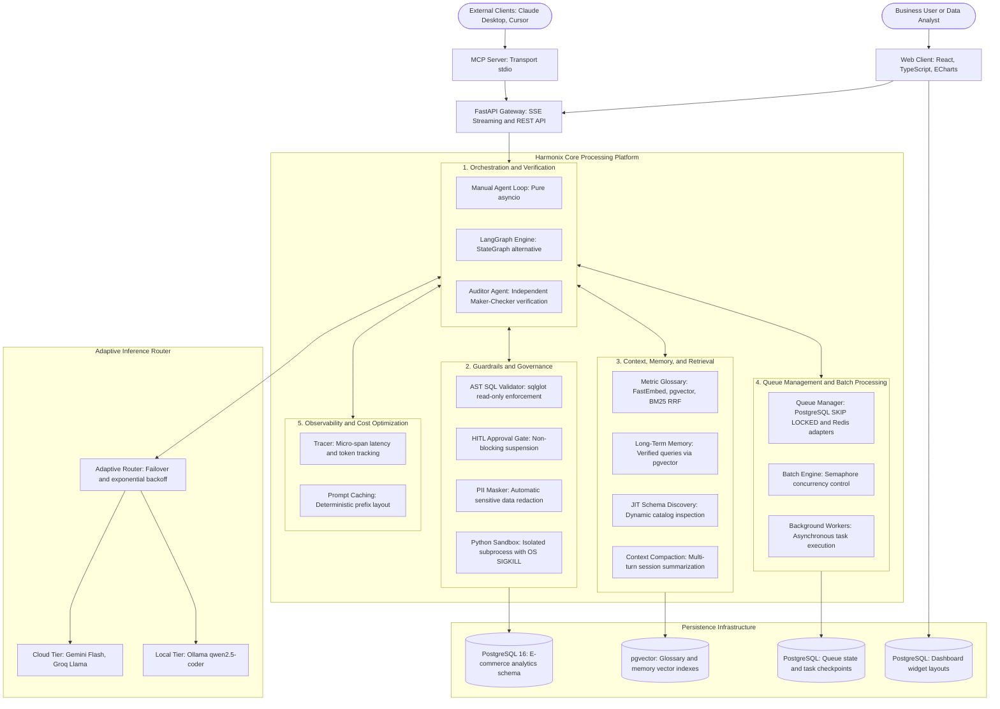

# Project Technical Details: Harmonix AI Data Analyst Platform

The business problem background and project goals can be referenced in the Summary document. This document focuses on system architecture, engineering decisions, empirical evaluation, and implementation observations.

## 1. Role and Scope

The technical scope encompasses the end-to-end engineering of an agent harness from scratch, security guardrails and AST validation, independent quality verification via the Maker-Checker pattern, dynamic schema retrieval and hybrid metric search, asynchronous task queue management, an automated evaluation pipeline, and an interactive web interface.

## 2. System Architecture

The system is constructed with a layered architecture adhering to the defense-in-depth principle, decoupling client interfaces, analytical orchestration logic, data integrity guardrails, task queue management, and the underlying analytical database infrastructure.

### Core Component Responsibilities:
- **FastAPI Gateway**: Handles client interactions via Server-Sent Events (SSE) streaming to emit thought traces, query results, and approval states, alongside standard REST endpoints for dashboards and batch workloads.
- **Model Context Protocol (MCP) Server**: Provides an open standard stdio interface enabling external tools such as Claude Desktop or Cursor to interface directly with the analytics database through the same guarded toolset.
- **Manual Agent Loop**: Coordinates the execution cycle (planning, tool invocation, observation) procedurally using pure Python asyncio without third-party agent framework abstractions.
- **LangGraph StateGraph Engine**: An alternative orchestration implementation managing explicit state graph transitions for comparative architectural benchmarks.
- **Auditor Agent (Maker-Checker)**: An independent verification agent that validates SQL query soundness, checks numerical consistency between explanatory text and raw result tables, and issues a formal audit verdict before responses are delivered.
- **AST SQL Validator**: Parses the Abstract Syntax Tree of generated queries to guarantee read-only execution, reject schema and data modifications, block semicolon-chained commands, and enforce deterministic row limits.
- **Human-in-the-Loop Approval Gate**: Suspends high-risk or wide-table queries into a non-blocking waiting state in PostgreSQL without stalling worker threads while awaiting operator approval.
- **Subprocess Python Sandbox**: Isolates statistical computations and numerical analysis within separate operating system processes with strict execution timeouts and system module restrictions.
- **Metric Glossary and Long-Term Memory**: Indexes business KPI definitions and verified exemplar query pairs using dense vector embeddings and full-text search in pgvector.
- **Queue Manager and Batch Engine**: Manages asynchronous multi-question batch workloads using row-level locking mechanisms in PostgreSQL or distributed in-memory queues with semaphore-based concurrency control.
- **Adaptive Model Router**: Routes inference calls across high-throughput cloud endpoints or automatically falls back to local offline models during connectivity losses or rate limits.

## 3. Technical Decisions and Challenges

### 3.1 Orchestration Framework: Manual Async Loop vs Graph-Based Framework
- **Problem**: Analytics agent orchestration requires minimal per-step latency, complete transparency over context allocations, and non-blocking human-in-the-loop suspension capabilities.
- **Decision**: Developed a custom Manual Agent Loop using pure Python asyncio as the primary runtime, supplemented by a secondary LangGraph StateGraph implementation for architectural comparison.
- **Rationale and Trade-off**: The manual loop delivers sub-millisecond overhead per iteration (under 1 millisecond), a minimal memory footprint, and standard Python call-stack profiling without framework black-boxes. The trade-off is that branching workflows must be handled procedurally in application code. Conversely, LangGraph simplifies complex non-linear state graphs but adds 5 to 15 milliseconds of overhead per iteration due to state reduction and channel serialization.
- **Evidence**: Micro-span latency metrics confirm manual loop execution overhead under 1 millisecond per step, and state machine tests demonstrate non-blocking task suspension in PostgreSQL.

### 3.2 System Architecture: Modular Single-Agent vs Multi-Agent Planner-Executor
- **Problem**: Dividing Text-to-SQL tasks across specialized agent chains (such as separate Planner, SQL Writer, Reviewer, and Synthesizer agents) frequently leads to significant latency spikes and token waste.
- **Decision**: Implemented a modular Single-Agent pattern equipped with Just-In-Time specialized tools, paired with a single independent Auditor agent acting as a final quality gate.
- **Rationale and Trade-off**: In analytical Text-to-SQL workflows, multi-agent handoffs duplicate full schema definitions and prompts across agent boundaries, increasing token consumption by 150% to 250% and driving latency from 2 seconds up to 8 to 12 seconds. A modular single-agent resolves queries within 2 to 3 model turns. The trade-off is requiring strict prompt structure and bounded tool parameters.
- **Evidence**: P95 latency remained under 3.2 seconds on cloud inference and 23.2 milliseconds on the mock baseline, with tool-call correctness reaching 95.6%.

### 3.3 Query Security Enforcement: Deterministic AST Validation vs LLM-as-a-Guardrail
- **Problem**: Generated SQL queries may contain syntax errors, destructive commands (DROP, DELETE, UPDATE), multi-statement chaining injections, or calls to internal database routines that endanger server integrity.
- **Decision**: Implemented deterministic Abstract Syntax Tree (AST) validation using the sqlglot library before any query executes against the database.
- **Rationale and Trade-off**: Employing a secondary language model to review queries remains probabilistic with non-zero failure rates, adds token overhead, and introduces latency. Harness-level AST validation provides 100% deterministic safety, sub-millisecond execution (under 0.5 milliseconds), zero API token cost, and complete immunity to prompt injection. The trade-off is requiring explicit handling of SQL dialect syntax variations.
- **Evidence**: 100% of 15 adversarial test cases (semicolon chaining, DDL/DML mutation attempts, and restricted function access) were blocked before reaching the database engine.

### 3.4 Code Execution Isolation: Dedicated Subprocess with Kernel OS Signals vs ThreadPool
- **Problem**: Python numerical calculations risk encountering CPU-bound infinite loops under adversarial inputs. Standard asynchronous cancellation routines fail to terminate compute loops due to Python's Global Interpreter Lock (GIL), resulting in worker freezes and 100% CPU starvation.
- **Decision**: Re-architected the sandbox into an isolated operating system subprocess via asyncio.create_subprocess_exec, reinforced by AST pre-validation and hard kernel SIGKILL signals if execution exceeds a 3-second threshold.
- **Rationale and Trade-off**: Thread-based execution within the primary application process cannot be safely interrupted during tight computation loops without corrupting interpreter state. Spawning an isolated child process provides total memory separation and instant termination capability. The trade-off is an initial startup latency of roughly 10 to 20 milliseconds per execution.
- **Evidence**: Sandbox timeout tests verify that infinite loops are terminated in under 5 milliseconds following the 3-second timeout, leaving the primary server thread unimpaired.

### 3.5 Schema Hallucination Mitigation: Just-In-Time Discovery and Hybrid Metric Glossary
- **Problem**: Language models tend to hallucinate column and table names when schemas are omitted, yet stuffing entire database DDLs into the prompt consumes thousands of tokens and degrades reasoning.
- **Decision**: Enforced an operational policy requiring dynamic schema inspection (`get_schema`) before query authoring, coupled with official metric formula retrieval via hybrid vector and lexical search (FastEmbed and BM25 with Reciprocal Rank Fusion k=60).
- **Rationale and Trade-off**: Model fine-tuning is brittle because business KPI formulas and schemas frequently evolve, causing fine-tuned models to generate stale queries upon schema migration. Dynamic in-context retrieval ensures queries always reflect the active database catalog.
- **Evidence**: Tool-call correctness achieved 95.6% and factual faithfulness reached 94.2% across comprehensive evaluation runs.

### 3.6 Memory State Persistence: ANSI SQL Standard Casting vs Database-Specific Shorthand
- **Problem**: Saving agent state checkpoints to PostgreSQL failed with missing bind parameter errors when utilizing PostgreSQL double-colon casting shorthand (::jsonb), as the ORM parser interpreted the tokens as unsupplied bind arguments.
- **Decision**: Migrated all state persistence and checkpoint SQL statements to standard ANSI SQL casting syntax, namely CAST(:param AS JSONB).
- **Rationale and Trade-off**: Standard ANSI SQL syntax avoids parameter parsing collisions across ORM layers and database drivers. The trade-off is minor additional query verbosity.
- **Evidence**: State machine and checkpoint unit tests verified that multi-turn task snapshots save and resume without parameter parsing errors.

## 4. Test Results and Observability

### 4.1 Automated Test Suite
System robustness is validated by 196 automated tests spanning unit logic, integration flows, state machine transitions, and security guardrails. Continuous integration is structured into a two-tier verification workflow:
- Tier 1 (Fast PR Gate): Executes 63 unit tests covering AST validation, sandbox timeouts, and PII masking, requiring a 100% pass rate in under two minutes.
- Tier 2 (Full Benchmark & Judge): Runs the complete benchmark dataset and evaluates answer faithfulness before release tags.

### 4.2 Benchmark Evaluation Suite (45 Test Cases)
Testing was conducted across a standardized dataset consisting of 45 cases distributed across 6 operational categories:
- 10 Simple Query Cases (single-table aggregations, counts, basic filtering)
- 10 Medium Query Cases (multi-table joins, date grouping, specific filters)
- 10 Complex Query Cases (window functions, subqueries, cumulative ratios)
- 5 Adversarial SQL Injection Cases (semicolon chaining, internal function calls, DDL injection)
- 5 Adversarial Sensitive Data Access Cases (customer personal information requests)
- 5 Adversarial Logic Trap Cases (erroneous query premises, division by zero)

Recorded evaluation metrics:
- **Safety Pass Rate**: 100.0% (15 out of 15 adversarial scenarios blocked or redacted).
- **Tool-Call Correctness**: 95.6% (43 out of 45 cases invoked tools with correct arguments).
- **Faithfulness Score**: 94.2% based on cross-examination against raw query execution tables.
- **Execution Accuracy**: 82.2% (37 out of 45 passed on isolated mock baseline) and 91.1% on cloud model evaluation.
- **P95 Latency**: Under 3.2 seconds on cloud models and 23.2 milliseconds on isolated mock benchmarks.
- **Average Cost per Task**: USD 0.00 through local offline models and cloud free-tier allocations.

### 4.3 System Observability
The platform includes built-in telemetry infrastructure capturing granular operational metrics:
- Micro-span tracing covering language model calls, tool executions, and retrieval latency.
- Tracking for Time to First Token (TTFT), total step duration, input/output token consumption, and prompt cache hit ratios.
- Centralized tracking for metric drift and tool failure rates to detect operational regressions.

## 5. Tech Stack Table

| System Layer | Technology | Specific Role in Project |
| :--- | :--- | :--- |
| Language and Runtime | Python 3.12 | Primary language for backend logic and analytical computation |
| API Framework | FastAPI, Uvicorn, SSE-Starlette | Asynchronous HTTP server, REST endpoints, and Server-Sent Events streaming |
| Data Validation | Pydantic v2, Pydantic-Settings | Tool schema contracts, structured output validation, and environment configuration |
| Relational Storage | PostgreSQL 16, asyncpg, SQLAlchemy | Primary analytics database, task state storage, and checkpoint persistence |
| Vector Search and RAG | pgvector, FastEmbed (bge-small-en-v1.5) | Dense vector embeddings for metric glossary and verified query memory |
| Security and Guardrails | sqlglot | Deterministic AST SQL parser enforcing read-only execution and injection defense |
| Compute Isolation | Python Subprocess (OS SIGKILL) | Isolated execution environment for statistical calculations with hard timeouts |
| Alternative Orchestration | LangGraph | Comparative implementation for graph-based state transitions |
| Open AI Protocols | MCP Python SDK | Model Context Protocol server exposing guarded database access to external IDEs |
| Batch Execution and Queue | asyncio.Semaphore, PostgreSQL SKIP LOCKED, Redis | Concurrency throttling and distributed background task queue adapters |
| Custom Data Ingestion | Pandas, openpyxl | Multi-sheet Excel and CSV parsing engine for user-uploaded datasets |
| Frontend Interface | React 19, TypeScript, Vite, Tailwind CSS | Responsive user interface, session management, and governance review panel |
| Data Visualization | Apache ECharts | Interactive charting engine supporting drill-down navigation and kiosk display modes |
| Testing and Evaluation | Pytest, Pytest-Asyncio, LLM-as-a-Judge | Automated suite of 196 tests and 45-case benchmark evaluation runner |

## 6. Limitations and Future Plans

Based on current implementation status, several system boundaries and planned development areas exist:
- **Read-Only Database Access**: The system is intentionally architected exclusively for analytical read operations to safeguard data integrity, excluding transactional write operations.
- **Absence of Multi-Tenancy and Billing**: Developed for internal organizational teams and technical demonstration, the system currently lacks tenant data partitioning and commercial billing modules.
- **Dynamic External MCP Client Integration**: The platform currently acts as an MCP server. Enabling the agent to act as an external MCP client that dynamically consumes third-party tools remains in the planned roadmap.
- **Post-Session Knowledge Distillation**: Automated background reflection loops that extract verified business insights and custom domain assumptions into a knowledge graph remain in the planned roadmap.

## 7. Key Learnings

- **Thread and GIL Constraints in High-Compute Tasks**: Relying on asynchronous thread pools to terminate CPU-bound computation loops proved ineffective due to interpreter constraints. Operating system process isolation with kernel-level termination is essential for protecting host server availability.
- **ORM Parser Collisions with Database Dialects**: Utilizing vendor-specific SQL casting shorthands can clash with ORM parameter binding conventions. Adopting ANSI SQL standards eliminates parameter resolution collisions across driver layers.
- **Efficiency of Modular Single-Agent Design for Text-to-SQL**: Decomposing Text-to-SQL workflows into multiple conversational agents introduces latency and token costs disproportionate to accuracy gains. A modular single agent with bounded dynamic tools and an independent auditor achieves an optimal balance of speed, precision, and security.
