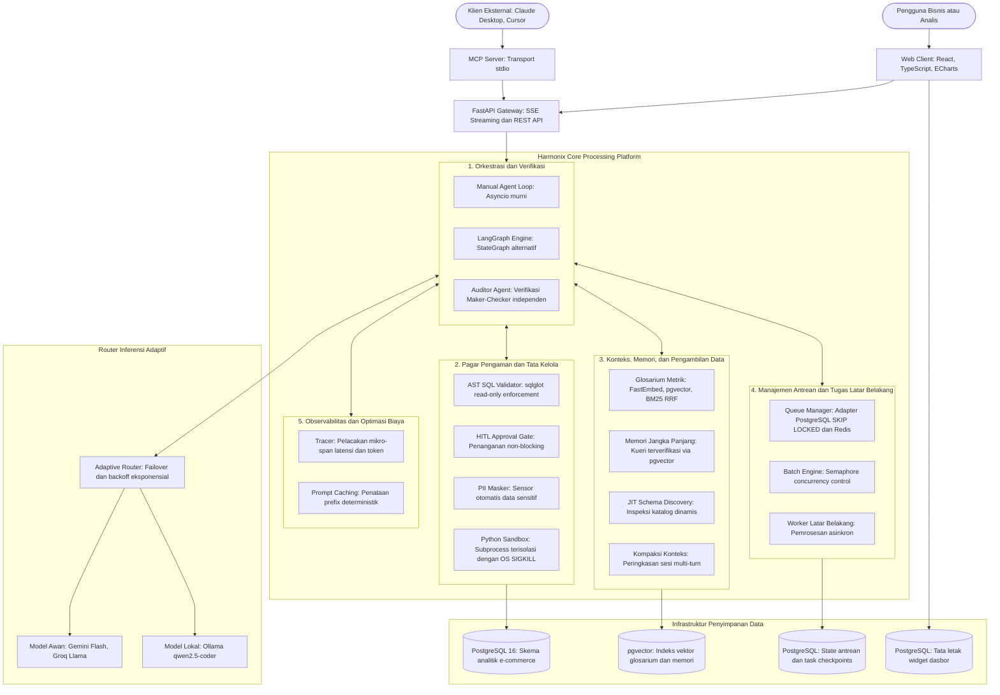

# Detail Teknis Proyek: Harmonix AI Data Analyst Platform

Latar belakang bisnis dan tujuan proyek bisa dilihat di dokumen Ringkasan. Dokumen ini berfokus pada arsitektur sistem, keputusan teknis, hasil pengujian, dan temuan dari proses pengembangan.

## 1. Peran dan Lingkup

Lingkup teknis proyek ini mencakup perancangan backend agent harness dari nol, sistem keamanan dan validasi AST, verifikasi independen dengan pola Maker-Checker, penelusuran skema dinamis dan pencarian metrik hibrida, pengelolaan antrean tugas asinkron, pipeline evaluasi otomatis, serta antarmuka web interaktif.

## 2. Arsitektur Sistem

Sistem ini dibangun dengan arsitektur berlapis yang menerapkan prinsip pertahanan mendalam (defense in depth). Setiap bagian dipisahkan dengan tegas: antarmuka web, logika orkestrasi agen, pagar pengaman integritas data, antrean pemrosesan tugas, serta database analitik.

### Tugas Komponen Utama:
- **FastAPI Gateway**: Mengurus komunikasi klien lewat streaming Server-Sent Events (SSE) untuk mengirimkan proses berpikir agen, hasil kueri, dan status persetujuan, serta menyediakan endpoint REST untuk dasbor dan eksekusi batch.
- **Model Context Protocol (MCP) Server**: Menyediakan pintu koneksi standar berbasis stdio agar aplikasi eksternal seperti Claude Desktop atau Cursor bisa mengakses database analitik lewat pagar pengaman yang sama.
- **Manual Agent Loop**: Mengatur siklus kerja agen (perencanaan, pemanggilan fungsi, observasi hasil) secara terstruktur menggunakan pustaka async Python murni tanpa ketergantungan framework agen pihak ketiga.
- **LangGraph StateGraph Engine**: Implementasi orkestrasi pembanding yang memakai graf keadaan formal untuk evaluasi latensi dan fleksibilitas alur kerja.
- **Auditor Agent (Maker-Checker)**: Agen pemeriksa independen yang memvalidasi logika SQL, memastikan angka di teks penjelasan cocok dengan tabel data mentah, dan memberikan status audit resmi sebelum jawaban dikirim ke pengguna.
- **AST SQL Validator**: Memeriksa pohon sintaks (Abstract Syntax Tree) kueri untuk memastikan sifatnya murni membaca data (read-only), memblokir modifikasi struktur atau isi tabel, menolak eksekusi banyak perintah sekaligus, dan menambahkan batas baris secara otomatis.
- **Human-in-the-Loop Approval Gate**: Menahan kueri yang berisiko tinggi ke status menunggu di database secara non-blocking, sehingga server tetap bebas melayani pengguna lain selagi menunggu persetujuan operator.
- **Subprocess Python Sandbox**: Menjalankan kode perhitungan statistik dan matematika dalam proses sistem operasi terpisah dengan batas waktu ketat dan pemblokiran modul sistem berbahaya.
- **Glosarium Metrik dan Memori Jangka Panjang**: Menyimpan definisi rumus bisnis resmi dan pasangan kueri yang sudah terbukti benar menggunakan pencarian vektor padat dan pencarian teks di pgvector.
- **Queue Manager dan Batch Engine**: Mengatur antrean pertanyaan massal menggunakan sistem penguncian baris di PostgreSQL atau Redis dengan pembatas konkurensi berbasis semaphore.
- **Adaptive Model Router**: Mengarahkan proses inferensi ke model awan yang cepat, serta otomatis beralih ke model lokal di komputer jika koneksi internet terputus atau batas kuota habis.

## 3. Keputusan Teknis dan Tantangan

### 3.1 Framework Orkestrasi: Manual Async Loop vs Framework Graf Eksternal
- **Masalah**: Agen analitik butuh waktu respon yang gesit, kendali penuh atas memori konteks, dan kemampuan berhenti sementara saat butuh persetujuan manusia tanpa membuat server macet.
- **Keputusan**: Membangun Manual Agent Loop memakai Python asyncio murni sebagai engine utama, ditambah versi alternatif memakai LangGraph StateGraph sebagai pembanding.
- **Alasan dan Trade-off**: Loop manual mencatat overhead latensi di bawah 1 milidetik per langkah, hemat memori, dan mudah di-debug karena memakai stack trace standar Python. Konsekuensinya, alur percabangan harus dikelola sendiri di dalam kode. Sementara itu, LangGraph membuat struktur alur graf terlihat rapi, tetapi menambah jeda 5 sampai 15 milidetik per langkah karena proses sinkronisasi state.
- **Bukti**: Pelacakan latensi mikro-span menunjukkan loop manual konsisten berjalan di bawah 1 milidetik per langkah, dan jeda persetujuan berhasil tersimpan rapi di database tanpa membuat worker thread menggantung.

### 3.2 Pola Arsitektur: Agen Tunggal Modular vs Rantai Banyak Agen (Multi-Agent)
- **Masalah**: Pola Text-to-SQL yang memecah tugas ke banyak agen khusus (seperti agen perencana, pembuat SQL, pemeriksa, dan perangkum) sering kali membuat respon jadi lambat dan boros biaya token.
- **Keputusan**: Memakai pola agen tunggal (single-agent) yang modular dengan perkakas dinamis Just-In-Time, didampingi satu agen Auditor independen untuk mengecek hasil akhir.
- **Alasan dan Trade-off**: Pada kasus Text-to-SQL, oper-operan antar-agen menduplikasi informasi skema berulang kali. Ini membuat biaya token melonjak 150% sampai 250% dan waktu tunggu naik dari 2 detik menjadi 8 sampai 12 detik. Agen tunggal yang modular mampu menyelesaikan tugas hanya dalam 2 sampai 3 putaran model. Konsekuensinya, instruksi sistem untuk agen tunggal harus dirancang sangat jelas dan terarah.
- **Bukti**: Waktu respon P95 berada di bawah 3,2 detik pada model awan dan 23,2 milidetik pada mock baseline, dengan ketepatan pemanggilan fungsi mencapai 95,6%.

### 3.3 Penegakan Keamanan Kueri: Validasi AST Pasti vs Pengawas Berbasis AI
- **Masalah**: Kueri SQL buatan AI berisiko salah sintaks, tidak sengaja mengubah data (DROP, DELETE, UPDATE), menyusupkan perintah berbahaya lewat titik-koma, atau memanggil fungsi database yang merusak server.
- **Keputusan**: Menggunakan validasi Abstract Syntax Tree (AST) secara matematis memakai pustaka sqlglot sebelum kueri dikirim ke database.
- **Alasan dan Trade-off**: Memakai AI kedua untuk memeriksa kueri masih bersifat tebak-tebakan, berpeluang salah, menambah biaya token, dan memperlambat sistem. Validasi AST di level mesin memberikan kepastian keamanan 100%, selesai dalam waktu kurang dari 0,5 milidetik, tanpa biaya token, dan kebal dari manipulasi prompt. Konsekuensinya, aturan validasi harus ditulis eksplisit untuk memahami variasi dialek SQL.
- **Bukti**: 100% dari 15 skenario pengujian serangan (injeksi titik-koma, perintah hapus data, dan pemanggilan fungsi berbahaya) berhasil dicegat sebelum sempat menyentuh database.

### 3.4 Isolasi Eksekusi Kode: Subprocess Mandiri dengan Sinyal Kernel OS vs ThreadPool
- **Masalah**: Perhitungan statistik rumit butuh eksekusi kode Python. Jika kode mengalami perulangan tanpa henti (infinite loop), pembatalan async biasa gagal menghentikannya karena batasan Global Interpreter Lock (GIL) di Python. Akibatnya, server membeku dengan beban CPU 100%.
- **Keputusan**: Menjalankan kode perhitungan di dalam proses sistem operasi terpisah via asyncio.create_subprocess_exec, lengkap dengan pemeriksaan modul berbahaya dan perintah matikan paksa (SIGKILL) dari kernel jika lewat dari 3 detik.
- **Alasan dan Trade-off**: Menjalankan kode acak di dalam thread aplikasi utama sangat berbahaya saat terjadi komputasi berat. Proses terpisah menjamin memori terisolasi penuh dan bisa dimatikan seketika. Konsekuensinya, ada jeda awal sekitar 10 sampai 20 milidetik untuk membuka proses baru.
- **Bukti**: Pengujian batas waktu kalkulasi membuktikan bahwa kode perulangan tanpa henti berhasil dimatikan dalam waktu kurang dari 5 milidetik setelah batas waktu 3 detik habis, tanpa mengganggu kinerja server utama.

### 3.5 Mengatasi Halusinasi Skema: Cek Skema Waktu-Nyata dan Glosarium Metrik
- **Masalah**: AI sering kali mengarang nama kolom atau tabel jika tidak diberi tahu strukturnya, tetapi menaruh seluruh isi tabel ke dalam prompt awal membuat boros ribuan token dan membingungkan model.
- **Keputusan**: Menetapkan aturan wajib bagi AI untuk memeriksa struktur tabel yang relevan terlebih dahulu lewat perkakas inspeksi katalog sebelum menulis kueri, didukung pencarian rumus metrik resmi memakai sistem pencarian hibrida (FastEmbed dan BM25 dengan Reciprocal Rank Fusion k=60).
- **Alasan dan Trade-off**: Menyetel ulang model (fine-tuning) tidak efektif karena struktur tabel dan definisi bisnis di perusahaan selalu berubah. Model hasil training akan cepat kedaluwarsa. Pendekatan membaca skema waktu-nyata menjamin kueri selalu sesuai dengan kondisi database terbaru.
- **Bukti**: Ketepatan pemanggilan fungsi mencapai 95,6% dan kesesuaian faktual mencapai 94,2% pada pengujian menyeluruh.

### 3.6 Penyimpanan Status Memori: Standar ANSI SQL vs Format Shorthand Database
- **Masalah**: Penyimpanan riwayat kerja agen ke PostgreSQL sempat gagal karena kueri memakai tanda titik dua ganda (::jsonb). Pustaka ORM mengira tanda tersebut adalah variabel yang lupa diisi nilainya.
- **Keputusan**: Mengubah semua kueri penyimpanan status dan checkpoint menjadi format standar ANSI SQL, yaitu CAST(:param AS JSONB).
- **Alasan dan Trade-off**: Format ANSI SQL dipahami secara seragam oleh semua pustaka database dan ORM tanpa memicu konflik pembacaan variabel. Konsekuensinya hanya penulisan kueri yang sedikit lebih panjang.
- **Bukti**: Pengujian unit pada mesin state membuktikan penyimpanan dan pemulihan riwayat percakapan berjalan lancar tanpa ada galat parsing.

## 4. Hasil Pengujian dan Observabilitas

### 4.1 Rangkaian Pengujian Otomatis
Keandalan sistem diuji lewat 196 pengujian otomatis yang mencakup pengujian unit logika, alur integrasi, mesin state, hingga pengujian pagar pengaman. Pengujian otomatis di sistem integrasi berkelanjutan dibagi menjadi dua tahap:
- Tahap 1 (Pemeriksaan Cepat): Menjalankan 63 tes validasi AST, isolasi kode, dan sensor data sensitif dengan syarat wajib lulus 100% dalam waktu kurang dari dua menit.
- Tahap 2 (Evaluasi Tolok Ukur Penuh): Menjalankan pengujian mendalam pada puluhan skenario analitik dan penilaian kualitas jawaban.

### 4.2 Hasil Evaluasi Tolok Ukur 45 Kasus Uji
Sistem diuji menggunakan 45 kasus uji terstandarisasi yang mencakup 6 kelompok kebutuhan:
- 10 Kasus Kueri Sederhana (agregasi dasar, hitung jumlah data, filter sederhana)
- 10 Kasus Kueri Menengah (gabungan beberapa tabel, pengelompokan tanggal, filter bertingkat)
- 10 Kasus Kueri Kompleks (fungsi jendela analitik, sub-kueri, perhitungan rasio bertingkat)
- 5 Kasus Serangan Injeksi SQL (penyusupan titik-koma, fungsi internal database, perintah manipulasi tabel)
- 5 Kasus Serangan Akses Data Sensitif (permintaan informasi kontak pelanggan)
- 5 Kasus Jebakan Logika dan Ambiguitas (pertanyaan dengan asumsi keliru, pembagian dengan angka nol)

Ringkasan hasil evaluasi yang diperoleh:
- **Tingkat Kelulusan Keamanan (Safety Pass Rate)**: 100,0% (seluruh 15 skenario serangan berhasil dicegat atau disamarkan).
- **Ketepatan Pemanggilan Fungsi (Tool-Call Correctness)**: 95,6% (43 dari 45 kasus memanggil fungsi yang tepat dengan argumen yang benar).
- **Skor Kesesuaian Faktual (Faithfulness Score)**: 94,2% berdasarkan pencocokan silang antara penjelasan narasi dengan angka tabel hasil kueri.
- **Akurasi Eksekusi Kueri**: 82,2% (37 dari 45 kasus berhasil dieksekusi dengan benar pada baseline pengujian lokal) dan 91,1% pada pengujian model awan.
- **Latensi Respon (P95)**: Di bawah 3,2 detik pada model awan dan 23,2 milidetik pada pengujian lokal terisolasi.
- **Biaya Rata-rata per Tugas**: USD 0,00 karena mengoptimalkan model lokal dan jatah layanan awan gratis.

### 4.3 Observabilitas Sistem
Sistem dilengkapi fitur pemantauan performa yang mencatat jalannya proses secara rinci:
- Pencatatan jejak waktu (span tracing) pada setiap pemanggilan model AI, pemanggilan fungsi, dan pengambilan data database.
- Pemantauan metrik kecepatan respon awal (Time to First Token), durasi tiap langkah, konsumsi token, dan tingkat keberhasilan cache prompt.
- Pelacakan anomali metrik dan tingkat kegagalan fungsi secara terpusat untuk mendeteksi penurunan performa sejak dini.

## 5. Tabel Tech Stack

| Lapisan Sistem | Teknologi | Fungsi Spesifik di Proyek |
| :--- | :--- | :--- |
| Bahasa dan Runtime | Python 3.12 | Bahasa utama untuk seluruh logika backend dan pengolahan analitik |
| Framework API | FastAPI, Uvicorn, SSE-Starlette | Server web asinkron, penyedia REST API, dan streaming Server-Sent Events |
| Validasi Data | Pydantic v2, Pydantic-Settings | Standar format input fungsi, validasi output terstruktur, dan pengaturan sistem |
| Database Relasional | PostgreSQL 16, asyncpg, SQLAlchemy | Tempat penyimpanan data analitik e-commerce, status tugas, dan checkpoint riwayat |
| Pencarian Vektor dan RAG | pgvector, FastEmbed (bge-small-en-v1.5) | Indeks vektor untuk pencarian glosarium rumus bisnis dan memori kueri terverifikasi |
| Keamanan dan Guardrail | sqlglot | Parser AST SQL untuk memastikan kueri murni read-only dan mencegah injeksi |
| Isolasi Komputasi | Python Subprocess (OS SIGKILL) | Ruang terpisah untuk perhitungan matematika dan statistik dengan batas waktu ketat |
| Orkestrasi Pembanding | LangGraph | Implementasi pembanding untuk pengujian alur berbasis graf keadaan formal |
| Protokol AI Terbuka | MCP Python SDK | Server Model Context Protocol agar database bisa diakses dari aplikasi IDE eksternal |
| Eksekusi Batch dan Antrean | asyncio.Semaphore, PostgreSQL SKIP LOCKED, Redis | Pengendali beban tugas massal dan antrean latar belakang |
| Pengolahan Data Pengguna | Pandas, openpyxl | Parser file Excel multi-sheet dan CSV untuk fitur unggah data mandiri |
| Antarmuka Pengguna | React 19, TypeScript, Vite, Tailwind CSS | Tampilan web interaktif, manajemen percakapan, dan panel persetujuan kueri |
| Visualisasi Data | Apache ECharts | Mesin pembuat grafik interaktif, navigasi drill-down data, dan mode layar penuh |
| Pengujian dan Evaluasi | Pytest, Pytest-Asyncio, LLM-as-a-Judge | Paket 196 pengujian otomatis dan runner evaluasi tolok ukur 45 kasus |

## 6. Keterbatasan dan Rencana Lanjutan

Berdasarkan kondisi sistem saat ini, ada beberapa batasan fungsional serta rencana pengembangan berikutnya:
- **Akses Database Murni Read-Only**: Sistem saat ini sengaja hanya membaca data agar database operasional tetap aman, sehingga belum mendukung aksi mengubah atau menambah data.
- **Belum Ada Multi-Tenant dan Billing**: Sistem ditujukan untuk kebutuhan internal dan portofolio arsitektur, sehingga belum dilengkapi pemisahan akun antar-perusahaan atau sistem langganan berbayar.
- **Koneksi Klien MCP Dinamis**: Saat ini sistem baru bertindak sebagai penyedia data lewat server MCP. Kemampuan bagi agen untuk terhubung ke perkakas eksternal dari pihak ketiga masih dalam tahap perencanaan.
- **Penyulingan Pengetahuan Pasca-Sesi (Knowledge Distillation)**: Proses otomatis di latar belakang yang menyaring wawasan baru dan aturan bisnis khusus dari obrolan lama ke dalam grafik pengetahuan masih dalam tahap perencanaan.

## 7. Pembelajaran

- **Batasan Thread dan GIL Python saat Komputasi Berat**: Mengandalkan thread biasa untuk menghentikan kode perulangan yang memakan CPU terbukti tidak ampuh karena batasan interpreter Python. Pemisahan proses di tingkat kernel sistem operasi adalah jalan keluar terbaik agar server tidak membeku.
- **Bentrokan Sintaks Database dengan Parser ORM**: Memakai tanda khusus dialek database tertentu (seperti titik dua ganda untuk ubah tipe data) bisa bertabrakan dengan sistem variabel ORM. Menggunakan format standar ANSI SQL terbukti menghilangkan masalah pembacaan variabel.
- **Kelebihan Agen Tunggal Modular untuk Text-to-SQL**: Membagi alur analitik ke banyak agen yang saling mengobrol justru membuat respon lambat dan boros biaya token tanpa menambah akurasi yang berarti. Agen tunggal yang dibekali perkakas dinamis dan diawasi oleh satu auditor mandiri memberikan kombinasi terbaik antara kecepatan, akurasi, dan kepastian keamanan.
